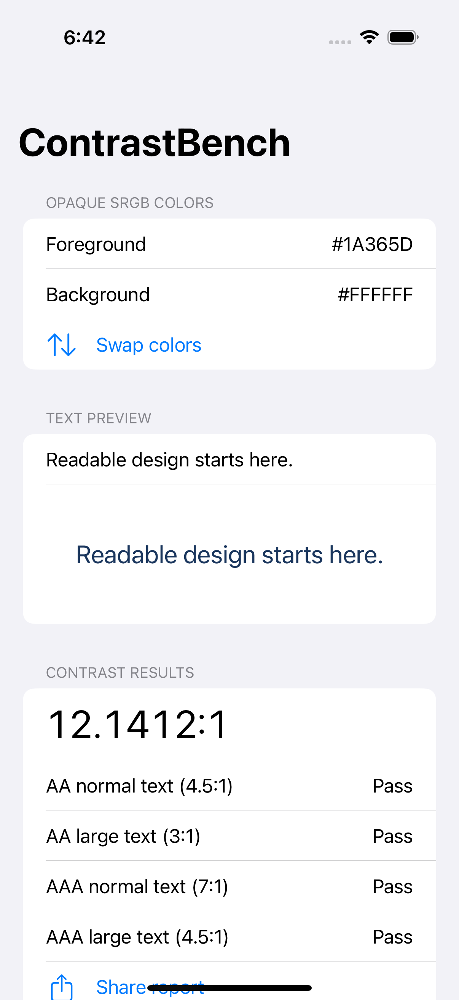

# ContrastBench iOS

[](https://github.com/Talk2rakesh-1/contrast-bench-ios/actions/workflows/ci.yml)

A native SwiftUI workbench for checking **opaque sRGB color pairs** before shipping text. Enter two hexadecimal colors, preview text, inspect WCAG contrast thresholds, swap colors, and share a plain-text report. Everything is computed on-device. No account, backend, paid API, or third-party runtime dependency.

Functional portfolio MVP. This calculates one color pair; it does not certify an app's accessibility or legal compliance. [Verification and remaining checks](docs/VERIFICATION.md).

## Run

Open `ContrastBench.xcodeproj` in Xcode 16+ and run the ContrastBench scheme on an iOS 17+ simulator. A device requires your own signing configuration; simulator use requires no paid Apple account. The generated Xcode project is committed. Optional regeneration: `xcodegen generate` (tested with 2.46.0).

1. Enter exactly six hex digits, optionally prefixed with `#`.
2. Change the foreground/background and sample text; results update immediately.
3. Review separate AA/AAA results for normal and large text.
4. Use **Swap colors** or **Share report**. Invalid input hides the report and gives guidance.

A useful boundary example: `#777777` on white fails AA normal text; `#767676` passes. Decisions use unrounded ratios, even when the displayed value looks close to a threshold.

## Simulator preview



Captured from the passing [UI smoke test](https://github.com/Talk2rakesh-1/contrast-bench-ios/actions/runs/40561357724). Physical-device and broader accessibility checks remain documented follow-ups.

## Design

`SwiftUI state → validated RGB → linearized sRGB luminance → ContrastResult → preview/report`

The pure `Sources/ContrastCore` library is independently testable through SwiftPM. The app compiles the same files directly. There is no persistence or networking layer. UI state resets on relaunch. Native labels, Dynamic Type, and text pass/fail statuses avoid relying on color alone; VoiceOver and large-text layout still require manual validation.

The preview uses explicit sRGB colors. Alpha compositing, gradients, photographs, Display P3, HDR, automated screenshot sampling, and full-interface audits are outside scope. Display settings and anti-aliasing can affect perceived readability. The preview font does not establish WCAG large-text eligibility.

## Verify

```sh
swift test
xcrun swift-format lint --strict -r App Sources Tests UITests Package.swift
xcodebuild -project ContrastBench.xcodeproj -scheme ContrastBench \
  -sdk iphonesimulator -configuration Release CODE_SIGNING_ALLOWED=NO build analyze
# Select an installed simulator UUID:
xcodebuild -project ContrastBench.xcodeproj -scheme ContrastBench \
  -destination 'platform=iOS Simulator,id=YOUR-SIMULATOR-UUID' CODE_SIGNING_ALLOWED=NO test
```

Eight core tests (including seven invalid-input parameter cases) cover known ratios, luminance, symmetry, normalization, full-precision thresholds, and report content. XCUITest covers launch, color swapping, and invalid input. CI also runs full-history Gitleaks. [Security](SECURITY.md), [research](docs/RESEARCH.md), [licensing](THIRD_PARTY.md).

MIT licensed. No external assets are bundled.
